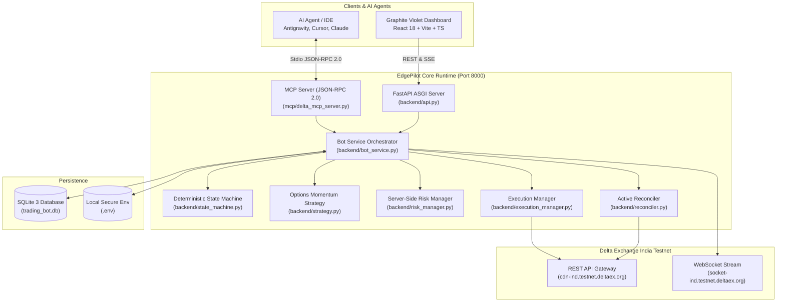
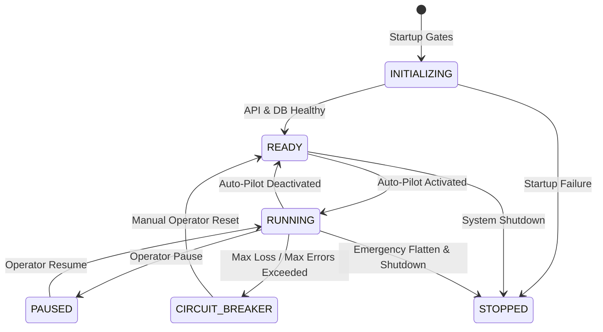
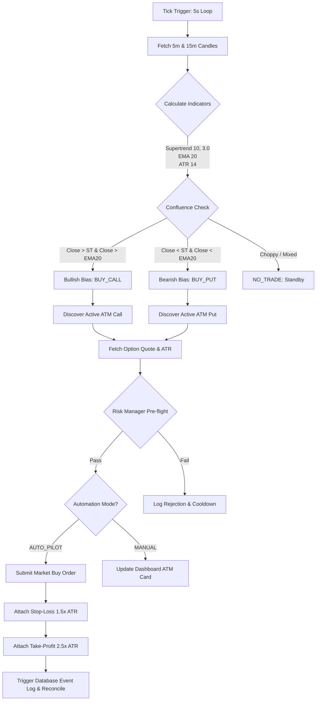
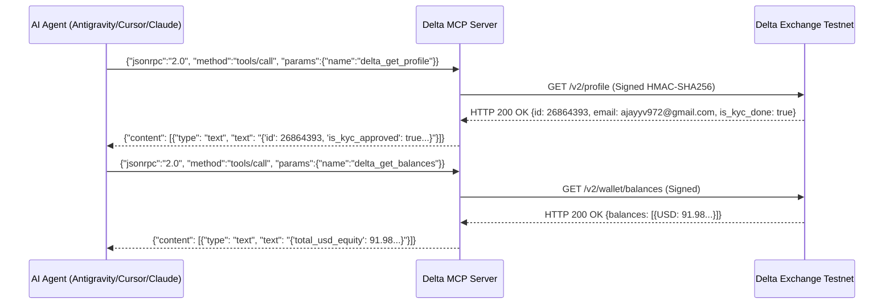

# System Architecture: EdgePilot (KIVO)

EdgePilot is an institutional-grade algorithmic option trading bot and Model Context Protocol (MCP) server engineered specifically for **Delta Exchange India Testnet**.

---

## 1. High-Level Architecture Diagram

---

## 2. Core Modules & Responsibilities

| Module | Location | Primary Responsibility |
| :--- | :--- | :--- |
| **ASGI Application** | `backend/api.py` | Exposes REST endpoints, mounts built Vite dashboard static assets, handles CORS, and controls background bot tasks. |
| **Bot Service** | `backend/bot_service.py` | Central coordinator: manages candle ingestion, strategy evaluation loop, live balance synchronization, and auto-pilot modes. |
| **State Machine** | `backend/state_machine.py` | Strictly validates lifecycle transitions (`INITIALIZING`, `READY`, `RUNNING`, `PAUSED`, `CIRCUIT_BREAKER`, `STOPPED`). |
| **Strategy Engine** | `backend/strategy.py` | Multi-timeframe trend analysis: 15m trend direction + 5m Supertrend (10, 3.0), EMA (20), and ATR volatility triggers. |
| **Risk Manager** | `backend/risk_manager.py` | Pre-flight order gating: enforces max open positions (1), daily loss limits (1.5%), cooldown intervals (300s), and spread filters. |
| **Execution Manager** | `backend/execution_manager.py` | Submits market orders, calculates option ATR brackets, attaches Stop-Loss and Take-Profit orders, and manages position sizes. |
| **Reconciler** | `backend/reconciler.py` | Periodic background reconciliation between Delta REST position endpoints and local database state to prevent phantom fills. |
| **Delta Client** | `backend/delta_client.py` | Low-level asynchronous HTTP client with HMAC-SHA256 request signing, self-healing clock offset calibration, and fail-closed host validation. |
| **MCP Server** | `mcp/delta_mcp_server.py` | Stdio JSON-RPC 2.0 server providing 9 tools for external AI agents to query balances, scan markets, and place option trades. |

---

## 3. Algorithmic State Machine Lifecycle

---

## 4. Option Strategy & Execution Flow

---

## 5. Model Context Protocol (MCP) Tool Surface

External agents interact over stdio with unbuffered JSON-RPC 2.0:

