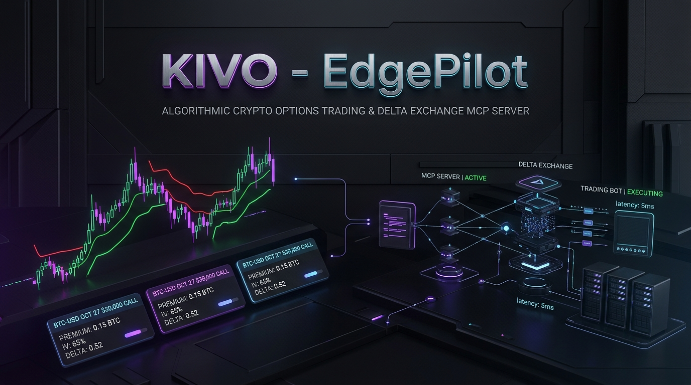
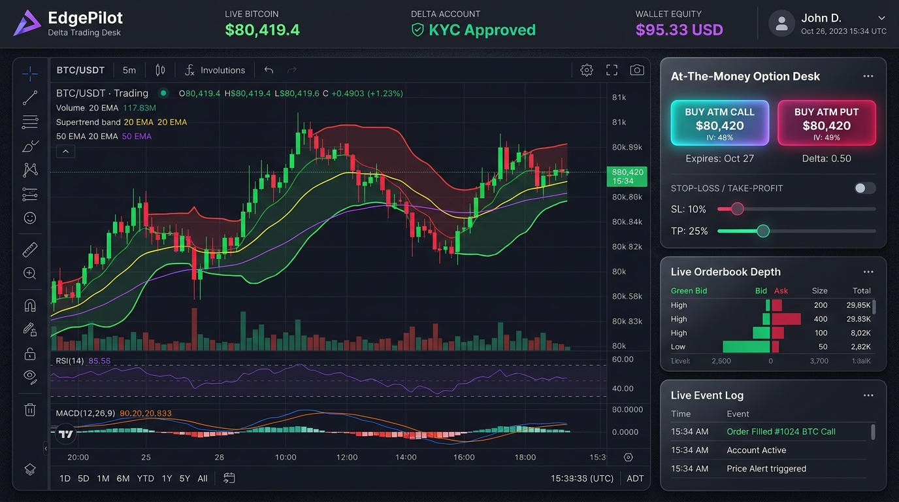
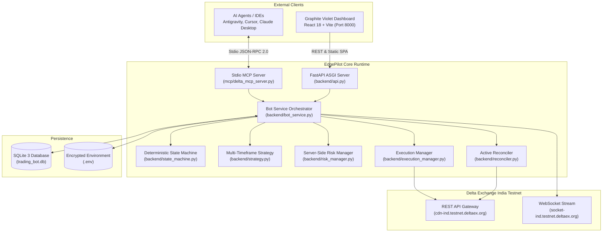

<p align="center">
  
</p>

<p align="center">
  <a href="https://github.com/ajayXcode/KIVO/actions"></a>
  <a href="https://fastapi.tiangolo.com/"></a>
  <a href="https://react.dev/"></a>
  <a href="https://www.typescriptlang.org/"></a>
  <a href="https://modelcontextprotocol.io/"></a>
  <a href="https://testnet.delta.exchange/"></a>
  <a href="LICENSE"></a>
</p>

---

# KIVO — EdgePilot: Algorithmic Option Trading Desk & Delta Exchange MCP Server

**EdgePilot** is an institutional-grade algorithmic option trading platform and Model Context Protocol (MCP) server engineered specifically for **Delta Exchange India Testnet**.

It combines a high-speed Python FastAPI backend with a reactive **Graphite Violet** trading dashboard (React 18 + Vite + TypeScript), automated multi-timeframe Supertrend/EMA momentum rules, real-time At-The-Money (ATM) option discovery, ATR-based bracket stop-loss execution, and a native **JSON-RPC 2.0 MCP server** for autonomous AI trading agents (Antigravity, Cursor, Claude).

---

## 📸 Dashboard Preview

<p align="center">
  
</p>

*The Graphite Violet desk displays live Bitcoin market feeds, instant 1-click ATM Call/Put order execution with automated ATR brackets, Delta KYC verification, wallet equity, Supertrend/EMA technical overlays, orderbook depth, and operational event logs.*

---

## ⚡ Key Highlights

- **🎯 At-The-Money (ATM) Option Engine**: Continuously discovers the most liquid active Call and Put contracts for **BTC**, **ETH**, and **XAUT** with the nearest settlement expiry.
- **📈 Algorithmic Trend & Volatility Filters**: Combines 15m trend direction with 5m Supertrend (10, 3.0), Exponential Moving Average (EMA 20), and 14-period Option Average True Range (ATR).
- **🛡️ Automated Protective Brackets**: Every option buy order automatically attaches a **1.5x ATR Stop-Loss** and a **2.5x ATR Take-Profit** protective limit order.
- **🤖 Autonomous Auto-Pilot**: When enabled, the bot automatically executes verified setups when price and indicator confluence align, or stands by gracefully in manual mode.
- **⚡ Instant 1-Click Execution**: Direct operator buttons (`⚡ BUY ATM CALL` / `⚡ BUY ATM PUT`) for immediate, guarded execution.
- **🧠 Native Delta MCP Server**: Full Model Context Protocol (MCP) server supporting stdio JSON-RPC 2.0 with 9 live tools for AI agents.
- **🔒 Fail-Closed Security Policy**: Hardcoded gatekeeper blocks production exchange endpoints (`api.delta.exchange`), ensuring operations are strictly confined to the Testnet environment.
- **🕒 Self-Healing Clock Synchronization**: Auto-recovering timestamp synchronization resolves edge CDN clock drift without `expired_signature` drops.
- **🐳 Enterprise Docker Deployment**: Multi-stage `Dockerfile` and `docker-compose.yml` preconfigured for `0.0.0.0:8000` deployment with volume persistence.

---

## 🏗️ System Architecture



---

## 🛠️ Model Context Protocol (MCP) Server

EdgePilot includes an autonomous **Delta Exchange MCP Server** ([mcp/delta_mcp_server.py](mcp/delta_mcp_server.py)) that exposes 9 real-time trading tools to AI agents:

| Tool Name | Parameters | Description |
| :--- | :--- | :--- |
| `delta_get_profile` | None | Retrieves user ID, verified email, KYC approval status, and country. |
| `delta_get_balances` | None | Returns balances across USD, USDT, and INR with net USD equity. |
| `delta_get_ticker` | `symbol` (e.g. `BTCUSD`) | Queries real-time spot price, mark price, best bid/ask, and 24h volume. |
| `delta_find_atm_option` | `underlying_asset`, `option_type` | Locates nearest operational ATM Call or Put option and quote price. |
| `delta_get_market_analysis`| `symbol` | Calculates Supertrend (10, 3.0), EMA 20, ATR 14, and recommended bias. |
| `delta_place_option_order` | `symbol`, `product_id`, `contracts`, `stop_loss_price` | Submits market buy order with protective Stop-Loss bracket. |
| `delta_get_positions` | `product_id` (optional) | Retrieves active open positions, entry prices, and unrealized PnL. |
| `delta_close_position` | `product_id`, `symbol`, `size` | Market-closes an open option or futures position immediately. |
| `delta_cancel_all_orders` | `product_id` | Emergency cancel all open orders for a product. |

### How to Connect to AI Agents (Cursor / Claude Desktop / Antigravity)

Add this entry to your `mcp_config.json` (or `claude_desktop_config.json`):

```json
{
  "mcpServers": {
    "delta-exchange": {
      "command": "python",
      "args": [
        "-u",
        "d:/KIVO/mcp/delta_mcp_server.py"
      ],
      "env": {
        "PYTHONPATH": "d:/KIVO",
        "DELTA_REST_URL": "https://cdn-ind.testnet.deltaex.org",
        "DELTA_WS_URL": "wss://socket-ind.testnet.deltaex.org",
        "ENVIRONMENT": "TESTNET"
      }
    }
  }
}
```

---

## 🚀 Quickstart Guide

### Option 1: One-Click Launch (Windows)
Double-click `run_bot.bat` or run in PowerShell:
```powershell
.\run_bot.ps1
```
The script activates the Python virtual environment, starts the FastAPI server, and launches your browser to **`http://localhost:8000`**.

---

### Option 2: Docker Compose (VPS / Production Linux)

```bash
# 1. Clone repository
git clone https://github.com/ajayXcode/KIVO.git
cd KIVO

# 2. Configure credentials
cp .env.example .env
nano .env

# 3. Start containers
docker compose up -d --build
```
Access the dashboard at **`http://<SERVER_IP>:8000`**.

---

### Option 3: Manual Local Development

```bash
# 1. Setup Python Environment
python -m venv .venv
.\.venv\Scripts\activate      # Windows
source .venv/bin/activate     # Linux / macOS

pip install -r requirements.txt

# 2. Build Dashboard Frontend
cd dashboard
npm install
npm run build
cd ..

# 3. Run Server
python -m backend.main
```

---

## ⚙️ Environment Configuration (`.env`)

```ini
# Environment Policy (Fail-Closed: Only TESTNET permitted)
ENVIRONMENT=TESTNET
DELTA_REST_URL=https://cdn-ind.testnet.deltaex.org
DELTA_WS_URL=wss://socket-ind.testnet.deltaex.org

# Delta Exchange Testnet Credentials
DELTA_API_KEY=your_testnet_api_key
DELTA_API_SECRET=your_testnet_api_secret

# Trading Pair & Timeframes
SYMBOL=BTCUSD
PRODUCT_ID=84
UNDERLYING_ASSET=BTC
TREND_TIMEFRAME=15m
ENTRY_TIMEFRAME=5m

# Risk Controls
MAX_OPEN_POSITIONS=1
MAX_SPREAD_TICKS=10
COOLDOWN_SECONDS=300
DAILY_LOSS_LIMIT_PCT=0.015

# Server Binding
HOST=0.0.0.0
PORT=8000
```

---

## 🛡️ Risk Controls & Circuit Breakers

EdgePilot enforces deterministic risk management prior to any order placement:
- **Max Positions Guard**: Strictly limits concurrent open option positions to `1`.
- **Spread Filter**: Rejects orders if bid/ask spread exceeds `10 ticks`.
- **Daily Loss Circuit Breaker**: Disables automated trading if daily loss reaches `1.5%`.
- **Order Cooldown**: Enforces a `300-second` pause following an order fill.
- **Log Sanitization**: Scrubbing filter replaces API keys and secrets with `[REDACTED]`.

---

## 🧪 Test Suite

EdgePilot features automated pytest test coverage:

```bash
python -m pytest -v
```

```
tests/test_api.py::test_health_live PASSED
tests/test_api.py::test_health_ready PASSED
tests/test_api.py::test_api_scanner PASSED
tests/test_delta_client.py::test_delta_client_credentials PASSED
tests/test_indicators.py::test_supertrend_calculation PASSED
tests/test_risk_manager.py::test_risk_manager_pre_trade_checks PASSED
tests/test_security.py::test_sensitive_data_redactor PASSED
============================== 22 passed in 1.53s ==============================
```

---

## 📂 Repository Structure

```
KIVO/
├── .agents/                 # Workspace Agent customizations & MCP configuration
├── .github/                 # CI/CD Workflows & Issue Templates
│   ├── workflows/ci.yml     # Automated multi-python CI pipeline
│   ├── ISSUE_TEMPLATE/      # Bug report & Feature request templates
│   └── PULL_REQUEST_TEMPLATE.md
├── assets/                  # Hero banner & dashboard preview mockups
├── backend/                 # Asynchronous Python Trading Engine
│   ├── api.py               # FastAPI ASGI server & REST routes
│   ├── bot_service.py       # Core orchestrator & strategy loop
│   ├── delta_client.py      # Authenticated Delta Exchange client
│   ├── execution_manager.py # Order execution & ATR bracket manager
│   ├── indicators.py        # Supertrend, EMA, ATR, RSI vector math
│   ├── market_data.py       # Candle ringbuffers & live tickers
│   ├── reconciler.py        # Position reconciliation engine
│   ├── risk_manager.py      # Circuit breakers & risk limits
│   ├── security.py          # Log redactor & credentials sanitization
│   └── state_machine.py     # Deterministic bot lifecycle
├── dashboard/               # Graphite Violet Trading Desk (React + Vite + TS)
│   ├── src/components/      # Trading desk components (ATM card, Chart, etc.)
│   └── dist/                # Pre-built production bundle mounted by FastAPI
├── mcp/                     # Model Context Protocol Server
│   ├── delta_mcp_server.py  # Stdio JSON-RPC 2.0 Server (9 Tools)
│   └── mcp_config.json      # Sample MCP client configuration
├── tests/                   # Pytest automated test suite
├── Dockerfile               # Multi-stage container build
├── docker-compose.yml       # Production docker-compose service
├── ARCHITECTURE.md          # In-depth architectural specification
├── CONTRIBUTING.md          # Contribution guidelines
├── CODE_OF_CONDUCT.md       # Contributor Covenant standard
├── SECURITY.md              # Security & vulnerability reporting policy
├── CHANGELOG.md             # Semantic version history
└── LICENSE                  # MIT License
```

---

## 📄 License & Attribution

This project is licensed under the **MIT License** — see the [LICENSE](LICENSE) file for details.

- **Author & Maintainer**: `ajayXcode` ([rangeshsha@gmail.com](mailto:rangeshsha@gmail.com))
- **Repository**: [https://github.com/ajayXcode/KIVO.git](https://github.com/ajayXcode/KIVO.git)
